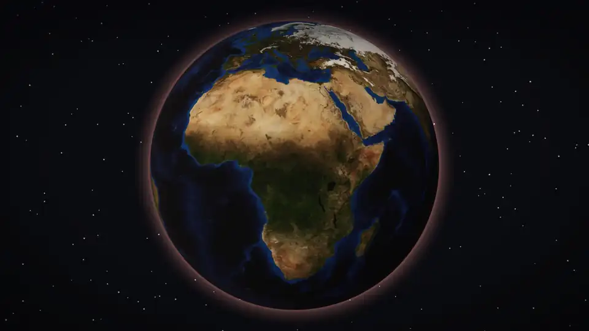
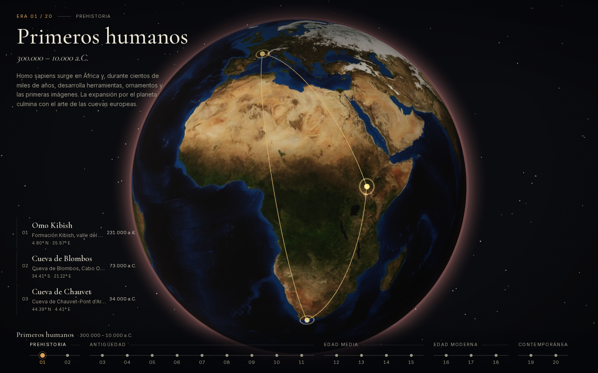
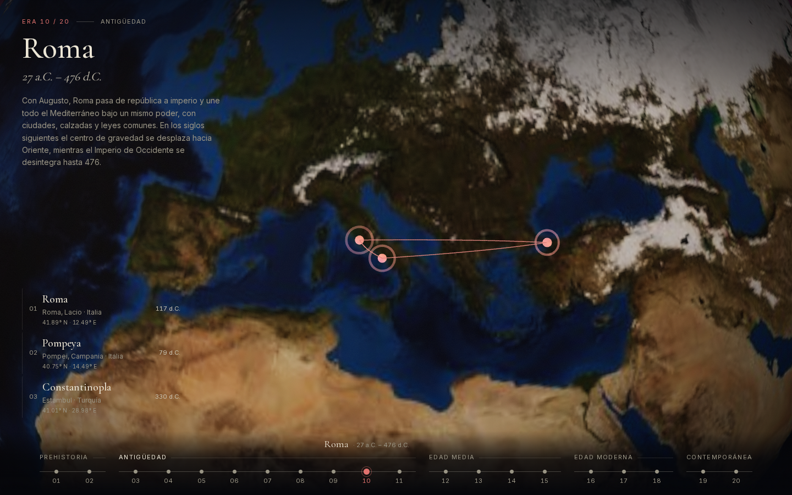
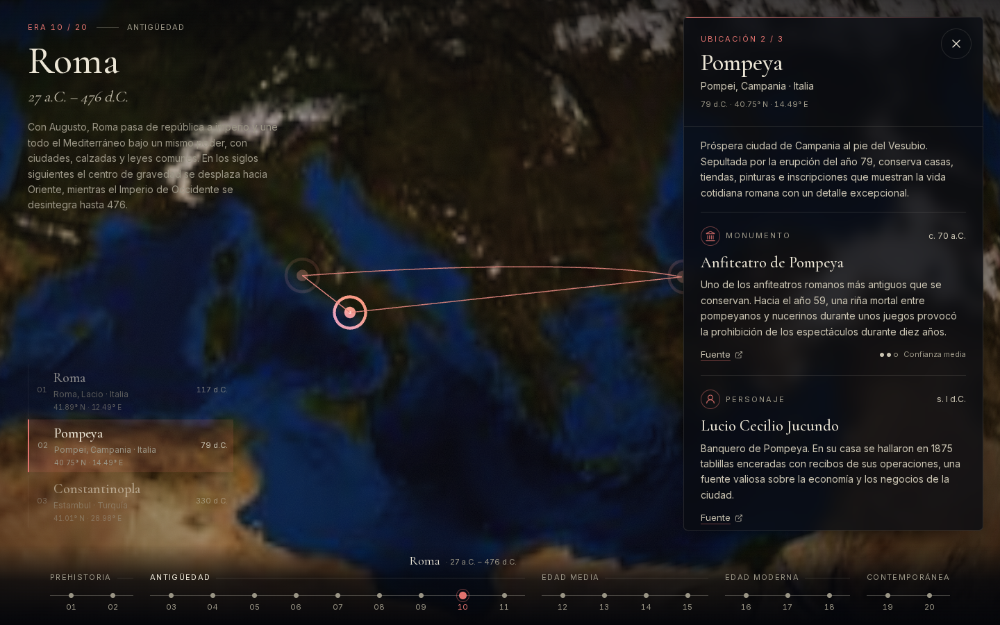
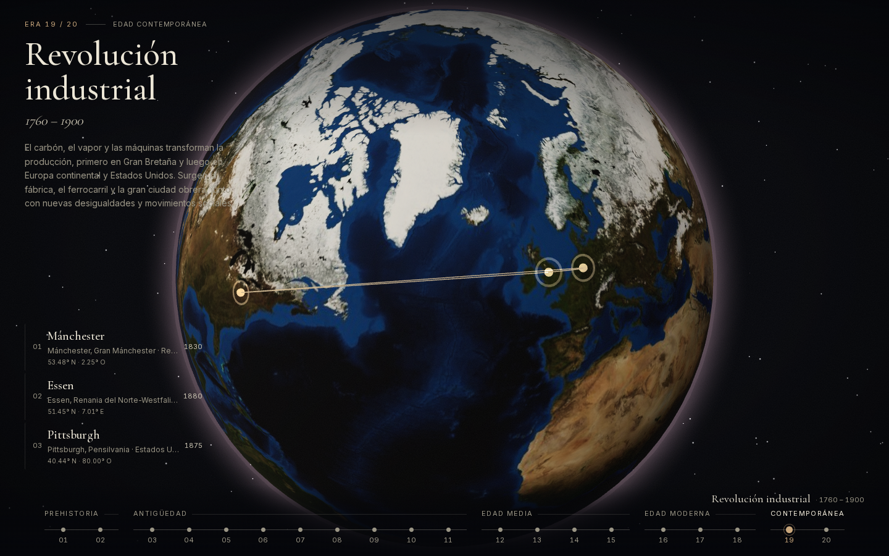
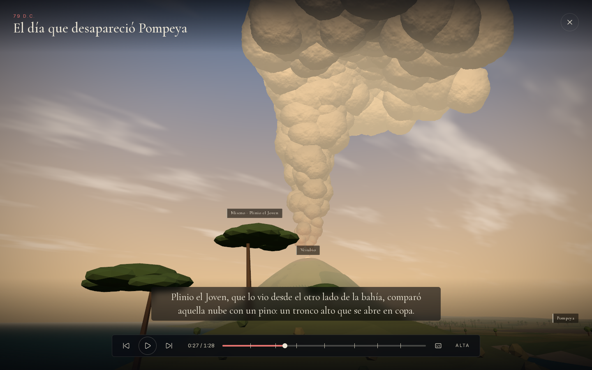
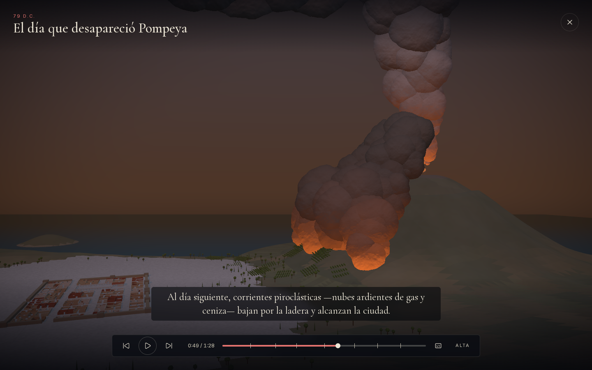
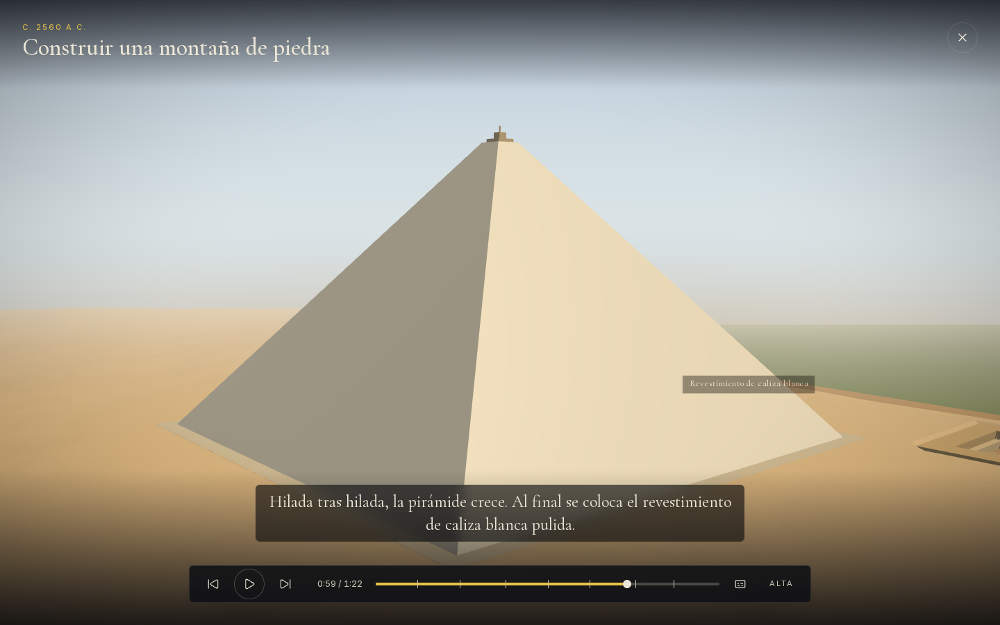
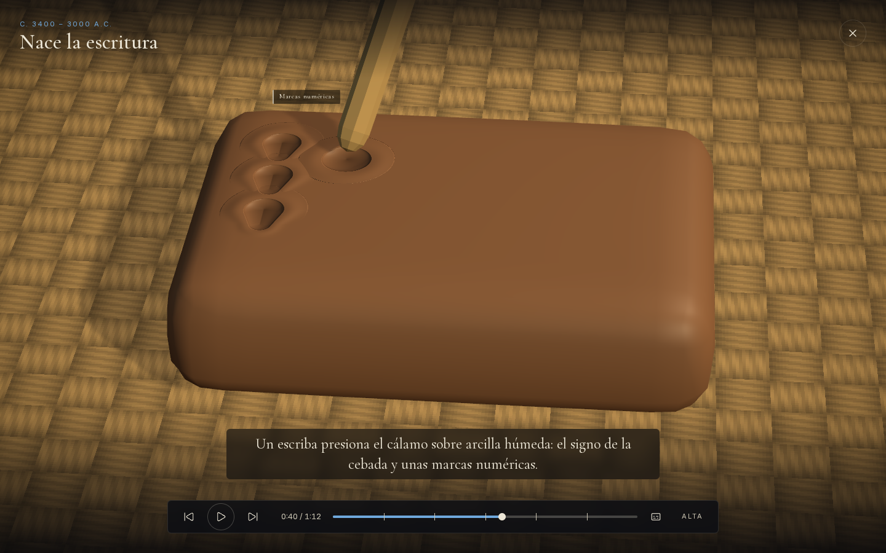
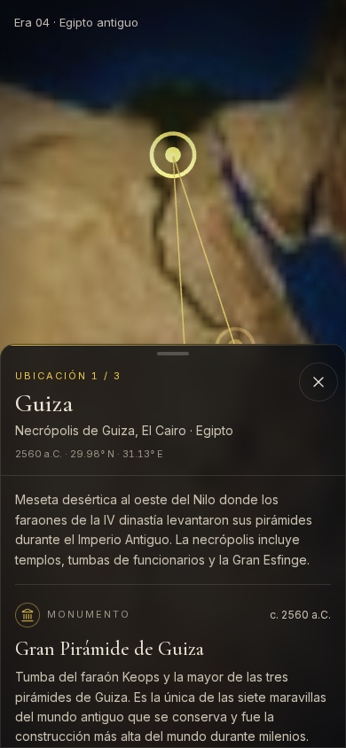

<div align="center">

# Cronotopo

### La historia de la humanidad, en un globo que puedes girar.

*El espacio es el globo. El tiempo es la línea. Tú eliges dónde y cuándo.*

<br>

<a href="docs/media/cronotopo-promo-1080p.mp4">
  
</a>

<sub>▶ <a href="docs/media/cronotopo-promo-1080p.mp4">Ver el video completo (1080p, 69 s)</a></sub>

<br><br>


**20 eras · 60 lugares · 300 elementos con fuente · 6 escenas animadas**

</div>

---

## Qué es

Cronotopo es un atlas interactivo de la historia. Eliges una era en la línea de tiempo y la cámara vuela al lugar del mundo donde ocurrió. Cada era tiene tres lugares, cada lugar cinco elementos: un monumento, un personaje, una tecnología, una expresión cultural y un acontecimiento. Todos llevan fecha, coordenadas, nivel de confianza y enlace a la fuente.

Desde los primeros *Homo sapiens* en Omo Kibish hasta el mundo contemporáneo, sin salir de una sola pantalla.

<table>
  <tr>
    <td width="50%"></td>
    <td width="50%"></td>
  </tr>
  <tr>
    <td><b>Elige una era.</b> Los marcadores aparecen y los arcos unen los lugares que la definen.</td>
    <td><b>La cámara viaja.</b> Un barrido de luz recorre el globo y el color de toda la interfaz cambia con la época.</td>
  </tr>
  <tr>
    <td></td>
    <td></td>
  </tr>
  <tr>
    <td><b>Abre un lugar.</b> Cinco tarjetas documentadas, con fuente y confianza explícitas.</td>
    <td><b>Del Paleolítico a hoy.</b> Veinte eras, ordenadas y validadas en cada build.</td>
  </tr>
</table>

## Escenas: la historia, contada en movimiento

Seis tarjetas abren un pequeño documental animado. No es video: es una escena 3D generada **100 % con código**, sin modelos ni texturas descargadas. Cada subtítulo describe exactamente lo que se ve en pantalla.

<table>
  <tr>
    <td width="50%"></td>
    <td width="50%"></td>
  </tr>
  <tr>
    <td colspan="2" align="center"><b>El día que desapareció Pompeya</b>: la columna «en forma de pino» que describió Plinio el Joven y las corrientes piroclásticas que sepultaron la ciudad.</td>
  </tr>
  <tr>
    <td></td>
    <td></td>
  </tr>
  <tr>
    <td align="center"><b>Construir una montaña de piedra</b> (Giza)</td>
    <td align="center"><b>Nace la escritura</b> (Uruk)</td>
  </tr>
</table>

| Escena | Abrir directamente |
|---|---|
| Nace la escritura · Uruk | `/?era=mesopotamia&loc=mesopotamia--uruk&scene=mesopotamia--uruk--technology` |
| Construir una montaña de piedra · Giza | `/?era=egipto-antiguo&loc=egipto-antiguo--giza&scene=egipto-antiguo--giza--landmark` |
| El templo de Atenea · Atenas | `/?era=grecia-clasica&loc=grecia-clasica--atenas&scene=grecia-clasica--atenas--landmark` |
| El día que desapareció Pompeya | `/?era=roma&loc=roma--pompeya&scene=roma--pompeya--event` |
| La máquina que multiplicó los libros · Maguncia | `/?era=renacimiento&loc=renacimiento--maguncia&scene=renacimiento--maguncia--technology` |
| La ciudad de las chimeneas · Mánchester | `/?era=revolucion-industrial&loc=revolucion-industrial--manchester&scene=revolucion-industrial--manchester--technology` |

Controles: <kbd>Espacio</kbd> play/pausa · <kbd>←</kbd>/<kbd>→</kbd> beat anterior/siguiente · <kbd>C</kbd> subtítulos · <kbd>Esc</kbd> cerrar.

## Lo que hay debajo

- **Coreografía de cine.** Cuatro timelines GSAP con nombre (intro, cambio de era, selección, cierre) que siguen una regla: lo importante se mueve primero y más. Todas se pueden interrumpir a mitad sin saltos.
- **Escenas deterministas.** El estado visual de cada escena es función pura del tiempo (timeline pausada + `seek`, PRNG con semilla), así que puedes adelantar, retroceder o enlazar cualquier segundo.
- **Contenido verificable.** Zod valida los 300 elementos en cada build: ids únicos, años coherentes, coordenadas en rango, una categoría por tarjeta, fuentes `https://`. Una auditoría adversarial corrigió errores factuales y coordenadas.
- **Motor agnóstico al contenido.** Para añadir una era basta un archivo de datos; la timeline, el globo y el panel se adaptan solos.
- **Accesible.** Navegación completa por teclado, foco gestionado, anuncios para lectores de pantalla y modo de movimiento reducido (fundidos en lugar de vuelos).
- **Responsive.** Panel lateral en escritorio y bottom sheet en móvil, sin scroll horizontal desde 360 px.
- **Ligero.** Export estático. Three.js y GSAP se cargan aparte del bundle inicial y cada escena se descarga solo al abrirla.
- **Enlazable.** El estado vive en la URL (`?era=roma&loc=roma--pompeya`) y los botones atrás/adelante del navegador funcionan.

<p align="center"></p>

## Empezar

Requisitos: Node 22+ y pnpm 11.

```bash
pnpm install
pnpm dev            # http://localhost:3000
pnpm build          # valida los datos y exporta el sitio estático a out/
pnpm start          # sirve out/
```

Para los tests e2e: `pnpm exec playwright install chromium`.

<details>
<summary><b>Todos los scripts</b></summary>

| Script | Qué hace |
|---|---|
| `pnpm dev` | Servidor de desarrollo |
| `pnpm build` | `validate:data` + `next build` (export estático en `out/`) |
| `pnpm start` | Sirve `out/` |
| `pnpm lint` | ESLint |
| `pnpm typecheck` | `tsc --noEmit` |
| `pnpm test` | Tests unitarios (Vitest) |
| `pnpm test:e2e` | Tests e2e (Playwright sobre `out/`; ejecuta antes `pnpm build`) |
| `pnpm test:motion` | Graba video y secuencias de frames de las 4 transiciones en `tests/motion-frames/` |
| `pnpm test:scenes` | Captura frames de las escenas animadas (`-- <id>` para una sola) |
| `pnpm validate:data` | Valida el contenido con zod (`pnpm validate:data <archivo-era.ts>` valida una sola era) |

</details>

<details>
<summary><b>Añadir una era</b></summary>

1. Crea `src/data/eras/NN-<id>.ts` con el tipo `HistoricalEra` (ver `src/domain/types.ts`).
2. Regístrala en `rawEras` de `src/data/index.ts`.
3. Actualiza `EXPECTED_ERA_COUNT` en `src/domain/schema.ts` (el MVP exige exactamente 20) y ejecuta `pnpm validate:data`.

</details>

<details>
<summary><b>Arquitectura</b></summary>

```
src/domain           tipos y esquema zod (sin React ni Three)
src/data/eras        20 archivos de era · src/data/index.ts los agrega y ordena
src/components/scene globo, atmósfera, estrellas, marcadores, arcos, cámara, director de coreografía
src/components/ui    timeline, cabecera, lista de lugares, panel, tarjetas
src/components/player reproductor de escenas (controles, subtítulos, scrubber)
src/scenes           contrato, registro, kit de primitivas y las 6 escenas
src/lib              geo, cámara, años, coreografía
src/store            estado global (Zustand): la única vía entre la escena 3D y la UI 2D
```

La memoria de trabajo completa (decisiones, coreografía, estado) está en [`CLAUDE.md`](CLAUDE.md).

</details>

## Créditos

- Textura de la Tierra: NASA Visible Earth, *Blue Marble Next Generation* (dominio público).
- Contenido histórico: cada elemento enlaza su fuente desde la propia tarjeta.
- Construido con [Claude Code](https://claude.com/claude-code).

<div align="center"><sub>Cronotopo: del griego <i>chrónos</i> (tiempo) y <i>tópos</i> (lugar).</sub></div>
